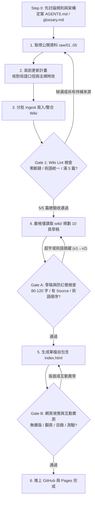

# 企業併購（M&A）與公平交易審查入門 — LLM Wiki 與教學 HTML 簡報

本專案依循「**先討論規範、再分批消化資料（Ingest）、經品質閘門檢查後生成教學簡報**」的雙迴圈架構，先從公開網頁與公平交易委員會官方文件建立結構化 **LLM Wiki**，再嚴格僅以該 Wiki 作為知識來源，產出一份 10 頁奶茶色極簡風格的可互動教學 HTML 簡報。

---

## 1. LLM Wiki 主題與簡短介紹

- **主題名稱**：《企業併購（M&A）與公平交易審查入門》
- **目標讀者**：沒有修過財務管理與商事法的一般大學生與日常消費者
- **知識庫簡介**：
  本 Wiki 透過三輪分批 Ingest，消化 5 篇涵蓋商管科普、公平會最新法規公告與台灣真實結合案的公開資料，建立 5 篇彼此雙向連結的概念與案例條目，以及 14 項跨領域術語對照表：
  1. `wiki/concepts/ma-overview.md`：併購（M&A）基本定義、五大交易形式、善意／惡意收購與五大動機。
  2. `wiki/concepts/merger-types.md`：水平、垂直、多角化併購比較，以及為何水平併購反壟斷審查最嚴格。
  3. `wiki/concepts/ftc-review.md`：台灣《公平交易法》第 10 條結合定義、**2026 年 1 月 28 日最新生效**申報門檻、等待期與第 13 條審查天平。
  4. `wiki/cases/pxmart-rtmart.md`：全聯併購大潤發結合案（市占 38%、前三大逾 3/4）之利益與疑慮衡量，以及 7 項行為面附加負擔。
  5. `wiki/concepts/compliance-risks.md`：第 39 條罰則、全聯 2024 罰鍰 2,000 萬與 2026 法院撤銷裁罰的執法舉證難題，以及 Uber Eats 併購 foodpanda 遭禁賠付 2.5 億美元分手費案例。

---

## 2. LLM Wiki 連結與專案成果

- **LLM Wiki 知識庫資料夾**：[`/wiki`](./wiki/)（GitHub 連結：`https://github.com/xncyu/ma-ftc-wiki-slides/tree/main/wiki`）
- **Wiki 總目錄導覽**：[`wiki/index.md`](./wiki/index.md)
- **協作規範與檢查規則**：[`AGENTS.md`](./AGENTS.md)
- **原始公開資料來源（唯讀）**：[`/raw`](./raw/)（共 5 篇，均附原始公開網址與發布／生效日期）

---

## 3. 教學 HTML 簡報連結與特色

- **教學 HTML 簡報公開網址（GitHub Pages）**：`https://xncyu.github.io/ma-ftc-wiki-slides/`
- **簡報原始檔**：[`index.html`](./index.html)（單一自包含檔案，CSS、JS 與 SVG 圖解全內嵌、零外部 CDN 依賴）
- **教學與互動設計**：
  - **10 頁循序漸進教學節奏**：從「買菜與叫外送」日常痛點切入 → 併購定義與三大類型 → 台灣公平會結合審查門檻與 SVG 審查天平圖解 → 全聯×大潤發 7 項附加負擔拆解 → 法規遵循成本與破局代價 → 第 10 頁重點口訣與互動隨堂小測驗。
  - **來源可追溯性**：每一頁右下角皆固定標註對應的 Wiki 知識庫檔案（例如 `Source: wiki/concepts/ftc-review.md`），確保內容零幻覺、不超出 Wiki 邊界。
  - **瀏覽操作**：支援鍵盤 `←` / `→` 翻頁、觸控滑動、上方進度條、右側快速目錄抽屜，以及桌面 16:9 與手機窄螢幕響應式防爆版排版。

---

## 4. Loop / Graph 流程圖與設計說明

### 設計說明（回答三個核心問題）
1. **哪些步驟會重複執行？**
   - **Loop 1（節點 1 → 2 → 3 → Gate 1）**：採「每次僅消化 1–2 篇資料」的滾動迭代，共重複執行 **3 輪**才完成 5 篇資料入庫；且第 2、3 輪都會回頭修改並整合既有的舊條目（如 `merger-types.md`、`pxmart-rtmart.md`），而非單純堆疊新檔。
   - **Loop 2（節點 4 → Gate A 與 節點 5 → Gate B）**：草稿超字或概念跳躍時重複退回文字精簡；HTML 渲染後若發現版面問題則重複微調 CSS／互動邏輯。
2. **哪些地方需要檢查或重新生成？**
   - 流程共設 **4 道檢查點**：(1) **寫前計畫核對**（攔截跨文章名詞不一與過時法規數字）；(2) **Gate 1 Wiki Lint**（檢查五段式格式、`[[雙向連結]]` 斷鏈與出處標記）；(3) **Gate A 草稿檢查**（強制單頁正文 80–120 字上限、來源檔名綁定與名詞定義順序）；(4) **Gate B HTML 實測**（檢查 16:9 與手機排版、翻頁與第 10 頁小測驗）。
3. **為什麼這樣設計？**
   - 如果採用單向線性流程（讀文章 → 直接生成 HTML），一旦發現「法條門檻引用舊制」、「單頁塞太多字導致網頁爆版」或「AI 偷補 Wiki 沒寫的知識」，直接修改 HTML 程式碼的成本非常高。將**「知識整合（Loop 1）」**與**「簡報呈現（Loop 2）」**分離，並在進 HTML 前加設純文字 **Gate A**，能讓絕大多數錯誤在純文字階段就被低成本攔截並退修。

---

## 5. 一次實際執行的結果與檢查紀錄（節錄自 `wiki/log.md`）

| 日期 | 階段／節點 | 動作或發現問題 | 修正方式與結果 |
| :--- | :--- | :--- | :--- |
| 2026-11-24 | Step 0：先討論後生成 | 定案主題、無商管背景讀者定位、10 頁奶茶色簡報風格與 `AGENTS.md` 雙迴圈規則 | 建立 `AGENTS.md`、`wiki/index.md`、`wiki/glossary.md` 與 `wiki/log.md` |
| 2026-11-24 | Loop 1・Round 1 寫前檢查 | 整理 `raw/01` 與 `raw/02` 時抓到兩處口徑不一：(1) 跨界收購 vs. 混合併購；(2) `raw/01` 僅寫「整併」未區分吸收／新設合併 | 寫檔前對齊術語：主文統一用「多角化併購」並括號註明別稱；嚴守防幻覺原則不腦補法條細分，更新 `glossary.md` |
| 2026-11-24 | Loop 1・Round 1 Lint | 掃描初版條目發現 `merger-types.md` 表格最右欄「垂直／多角化監管關注度」尚缺法條出處 | 標記為待補缺口，於 Round 2 匯入公平法原文後正式回補法條依據 |
| 2026-11-24 | Loop 1・Round 2 寫前檢查 | 查核公平會官網發現，網路多數舊文仍引用舊銷售額門檻（400 億／150 億／20 億），但公平會已於 **2026-01-28** 公告調高為 **500 億／200 億／30 億元** | 採納 2026-01-28 最新公告標準寫入 `raw/03` 與 `ftc-review.md`，避開過時法條數據錯誤 |
| 2026-11-24 | Loop 1・Round 3 寫前檢查 | 核對 `raw/05` 裁罰新聞稿時發現：Round 2 按主題重排的 7 項負擔順序與公平會正式決定書項次不同（刪除最惠客戶條款實為**官方負擔第 6 項**）；另舊檔仍殘留 `待補` 註記 | 改為無編號主題分組，僅針對已確認的「官方負擔第 1 項、第 6 項」加註原項次（不猜測未載明項次）；同步清除舊檔全部過期註記，完成 5/5 篇零斷鏈總驗收 |
| 2026-11-24 | Loop 2・Gate A 草稿檢查（v1 → v2 退修） | 攔截 3 處未通過項目：(1) P6、P8、P9 初稿達 **125–135 字**超過 120 字上限；(2) P7 提及「最惠客戶條款」未附白話解釋；(3) P10 小測驗出現「結構面」但前頁尚未定義 | 退回純文字草稿重修：將 P6／P8／P9 精簡壓回 **111–116 字**；P7 括號補註「（要求比照他家低價）」；P8 開頭補入「未用結構面（賣資產）」，全數符合規範 |
| 2026-11-24 | Loop 2・Gate B HTML 實測 | 產出單一自包含 `index.html` 並檢查桌機 16:9 與手機窄螢幕排版、按鍵翻頁、目錄抽屜與 P10 測驗 | 全部通過，無文字爆版或樣式遺失 |

---

## 6. 反思

1. **哪一個節點最常出錯？**
   - **節點 A（跨來源 Ingest 整合節點）**：不同公開文章的寫作時間與視角不同，最容易出現「同一概念三種叫法（跨界／混合／多角化）」、「引用到調高前的舊法條門檻」，以及「依主題重排清單後與官方決定書項次對不起來」這類細微事實衝突。
   - **節點 B（簡報內容草稿壓縮節點）**：在把高資訊密度的法規門檻（P6）、7 項負擔（P8）與罰鍰訴訟（P9）濃縮成新手簡報時，初稿很容易超過 120 字上限，或是為了省字數而跳過「最惠客戶條款」、「結構面」等專有名詞的白話定義，導致新手看到後面小測驗時卡關。
2. **發現問題後，把檢查往前移到了哪一個步驟？**
   - **把「排版防爆版與術語完整性檢查」從生成 HTML 之後（Gate B）往前移到純文字草稿階段（Gate A）**：原本容易等到 HTML 網頁生出來、用瀏覽器打開看到文字超出卡片才回頭改；這次把單頁 80–120 字硬上限與術語定義順序檢查前移到 Gate A，在純文字階段就把超字的 P6、P8、P9 退修成 v2，進入 HTML 後一次就過關。
   - **把「術語統一與法規時效核對」從製作簡報階段往前移到每輪寫檔前計畫與 Gate 1 Lint**：建立 `wiki/glossary.md` 並在寫檔前先核對官網生效日期，避免錯誤資訊流進簡報。
3. **有沒有因此修改 workflow / graph？為什麼？**
   - **有，做了兩項具體調整**：
     1. **將單向線性流程改為「雙迴圈＋三道閘門（Gate 1 / Gate A / Gate B）」**：明確拆開「知識庫建置迴圈」與「簡報製作迴圈」，並規定簡報階段只能讀取 `wiki/`、每頁強制標註 `Source: wiki/...`，從流程結構上杜絕幻覺與高成本的 HTML 返工。
     2. **將部署架構調整為「根目錄單一自包含 `index.html`」**：不拆外部 CSS/JS 檔案、也不依賴外部 CDN，同時在 CSS 加入手機寬度（`≤ 768px`）自動切換垂直捲動卡片的規則，從根本消除 GitHub Pages 相對路徑 404 與跨裝置爆版風險。
